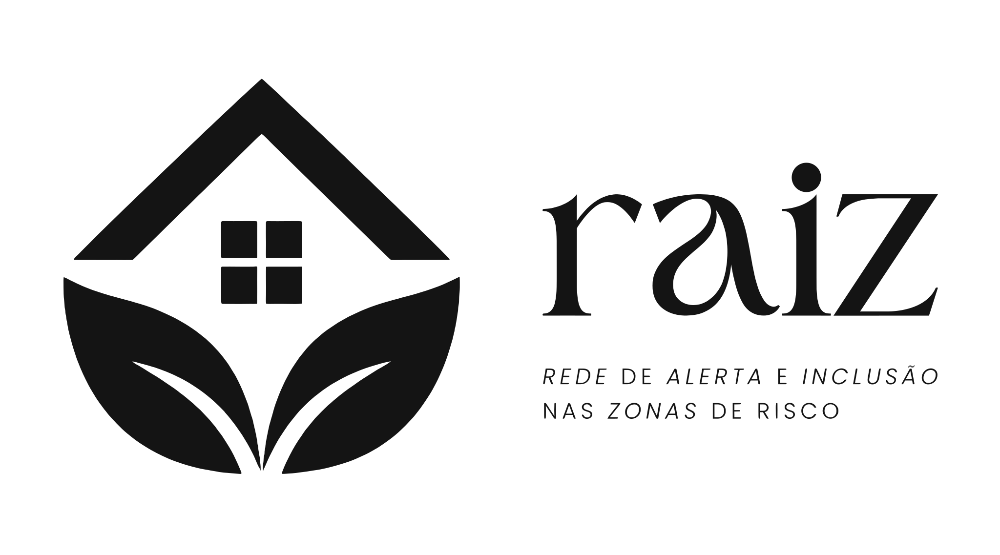
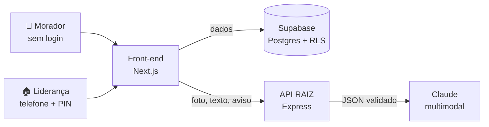

<p align="center">
  <picture>
    <source media="(prefers-color-scheme: dark)" srcset="frontend/public/marca/logo-raiz-branco.svg">
    
  </picture>
</p>

<h3 align="center">Rede de Alerta e Inclusão nas Zonas de risco</h3>

<p align="center">
  O morador mostra o sinal de risco e ouve o que fazer.<br>
  A liderança comunitária sabe qual casa visitar primeiro.
</p>

<p align="center">
  <a href="https://github.com/luizsen4/Hackthon-APONTI/actions/workflows/ci.yml"></a>
  
  
  
  
  
</p>

---

> **[EQUIPE 01] · Hackathon APONTI Academy 2026**<br>
> **Desafio:** Antena na Lama (REC'n'Play 2026) · **Caminho escolhido:** Alertar e proteger

## Sumário
- [Sobre o projeto](#-sobre-o-projeto)
- [Como funciona](#-como-funciona)
- [Equipe](#-equipe)
- [Tecnologias utilizadas](#-tecnologias-utilizadas)
- [Arquitetura](#-arquitetura)
- [Uso ético de IA](#-uso-ético-de-ia-obrigatório-pelo-edital)
- [Como rodar localmente](#-como-rodar-o-projeto-localmente)
- [Testes automatizados](#-testes-automatizados)
- [Deploy público](#-deploy-público)
- [Segurança e privacidade](#-segurança-e-privacidade)
- [Próximos passos](#-próximos-passos)
- [Contribuindo](#-contribuindo)
- [Licença](#-licença)

## 📖 Sobre o projeto
Em áreas de risco da Região Metropolitana do Recife, o alerta oficial chega igual para todos e não alcança bem quem **não lê, não ouve, não tem celular ou não consegue sair de casa sozinho**. Os sinais de perigo vistos na rua (lona rasgada, rachadura, água de barro descendo, lixo no canal) raramente viram aviso a tempo, e a liderança comunitária não tem uma lista de quem precisa de ajuda primeiro.

O **RAIZ** liga as duas pontas: o morador que vê o sinal e a liderança que conhece cada casa.

| | O que o RAIZ faz | O que o RAIZ **não** faz |
|---|---|---|
| Morador | Reconhece o sinal por foto, fala ou desenho e lê em voz alta a orientação oficial | Não diz que um lugar é “seguro” nem indica rota |
| Liderança | Ordena as casas para visita pelo risco da área e por quem mora nelas | Não substitui a Defesa Civil nem emite alerta oficial |
| IA | Interpreta foto, fala e relato livre; adapta o aviso ao canal de cada pessoa | Não escreve a orientação: ela é sempre um texto fixo do catálogo |

> **Limite da evidência:** o protótipo demonstra viabilidade técnica e operacional. O impacto em vidas ainda não foi medido.

## 🧭 Como funciona
**Morador** (sem senha e sem instalar nada)
1. **Ver:** tira uma foto, fala ou toca no desenho do sinal.
2. **Entender:** a IA reconhece o sinal entre 7 opções; o app lê a orientação oficial em voz alta.
3. **Avisar:** envia para a liderança, identificando-se com selfie ou CPF.
4. **Pedir cadastro:** para si ou para alguém da casa (ex.: a avó), e acompanha o status no painel.

**Liderança** (conta com telefone e PIN)
1. Cadastra **residências** e seus **moradores**: pessoa idosa, gestante, criança, acamada, cadeira de rodas, dificuldade para entender, “Outro”…
2. Vê o **mapa** das áreas de risco (R1 a R4), os sinais recentes e as casas numeradas na ordem de visita.
3. Recebe **mensagens**: pedidos de cadastro e sinais de risco, com quem enviou.
4. Gera a **mensagem no canal certo** de cada casa: visita, áudio, texto fácil, Libras ou ligação.
5. Publica **avisos** para a comunidade: urgente, abrigo aberto, aviso e campanha.

**Acessibilidade em todas as telas:** questionário na primeira entrada (ouvir e/ou ler, 5 tamanhos de letra, botões médios ou grandes), temas claro, escuro e alto contraste, leitura em voz alta e ditado, e barra fixa para ligar 199, 193 e 192.

## 👥 Equipe
*   **Desenvolvedores:**
    *   Emerson Júnior
    *   Luiz Martins
    *   Lytuanne Buarque
    *   Matheus Alves
*   **Validador(a) (Movimento Pró-Criança):**
    *   Tayza Kevinlyn

## 🚀 Tecnologias utilizadas
| Camada | Tecnologia |
|---|---|
| **Front-end** | Next.js 14 (App Router), React 18, TypeScript, Tailwind CSS + design system RAIZ, Web Speech API (voz e ditado), mobile-first |
| **Back-end** | Node.js 22, Express 5, TypeScript, Zod, Helmet, rate limit |
| **IA** | Claude (Anthropic), modelo multimodal com saída JSON validada |
| **Banco de dados** | Supabase: Postgres, Auth, Realtime e Row Level Security por comunidade |
| **Deploy** | Vercel (front-end) · Render (API) · Supabase (banco) |
| **Testes e CI** | Vitest, Supertest, GitHub Actions |

> Sem o Supabase configurado, o app roda em **modo demonstração**, com dados fictícios guardados no navegador.

## 🧱 Arquitetura


```
frontend/                 Next.js (telas)
  src/app/                rotas: / · /ajustes · /morador · /pedido · /conta · /lideranca · /lideranca/cadastro
  src/components/         cabeçalho, mapa, avisos, cartões da liderança, campos (CPF, selfie, foto, ditado)
  src/domain/             regras puras e testadas: catálogo, ordem de visita, CPF, palavras proibidas
  src/data/               contrato de dados + implementações em memória (demo) e Supabase
  src/lib/                cliente da API de IA, voz, imagem, preferências de acessibilidade
  src/styles/             design system RAIZ (tokens claro, escuro e alto contraste)
backend/                  API Express com as funções de IA protegidas no servidor
  src/rotas/ia.ts         POST /api/ia/sinal · /cadastro · /mensagem · /aviso
  src/ia/                 prompts, guardas e cliente do modelo
supabase/migrations/      tabelas e políticas de acesso (RLS)
docs/                     arquitetura e segurança/LGPD
```

Detalhes em [`docs/ARQUITETURA.md`](docs/ARQUITETURA.md).

## 🤖 Uso ético de IA (Obrigatório pelo Edital)
*   **Onde a IA foi usada no produto:**
    1. Foto ou texto do morador → uma chave de uma **lista fechada** de 7 sinais.
    2. Relato livre da liderança → campos do cadastro, **sempre conferidos por uma pessoa** antes de salvar.
    3. Aviso oficial → mensagem no canal de cada pessoa.
    4. Aviso da liderança → linguagem simples.
*   **Onde a IA foi usada no desenvolvimento:** Claude (Anthropic) apoiou a pesquisa, o protótipo, a interface, a organização do código (front-end, API e SQL) e os testes.
*   **O que foi corrigido/validado:**
    *   A orientação ao morador saiu da IA e virou **texto fixo por sinal**.
    *   A resposta do modelo é validada: chave fora da lista ou confiança baixa vira “não deu para ter certeza, escolha pelo desenho”.
    *   O **CPF é retirado** antes de qualquer chamada ao modelo.
    *   Respostas com “seguro”, “sem risco” ou “rota” são descartadas e volta o texto oficial.
    *   Doença citada no relato não é guardada; fica só a dificuldade prática.
    *   A chave do modelo fica só no servidor; sem ela, a API responde 503 e o app segue no modo manual.
*   **Ferramentas usadas:** Claude (Anthropic).

## 🧰 Como rodar o projeto localmente
### Pré-requisitos
Node.js 22.12+ · chave da API da Anthropic (opcional) · projeto no Supabase (opcional)

### Back-end
```bash
cd backend
cp .env.example .env      # ANTHROPIC_API_KEY (sem ela a IA responde 503 e o app usa o modo manual)
npm install
npm run dev               # http://localhost:4000/api/saude
```

### Front-end
```bash
cd frontend
cp .env.example .env.local   # NEXT_PUBLIC_API_URL=http://localhost:4000 · Supabase opcional
npm install
npm run dev                  # http://localhost:3000
```

**Demonstração rápida (sem Supabase):** na tela inicial, toque em **Usar conta de exemplo** (telefone 81 9 0000-0000, PIN 123456) e depois em **Carregar comunidade de exemplo**. Todos os dados são fictícios e ficam só no navegador.

### Banco (opcional)
1. Crie um projeto no Supabase e rode [`supabase/migrations/0001_raiz.sql`](supabase/migrations/0001_raiz.sql) no SQL Editor.
2. Ative **Anonymous sign-ins** (o morador não tem conta).
3. Preencha `NEXT_PUBLIC_SUPABASE_URL` e `NEXT_PUBLIC_SUPABASE_ANON_KEY` no `.env.local`.

## 🧪 Testes automatizados
15 testes rodam no CI (GitHub Actions) a cada push e Pull Request.

```bash
cd backend && npm test     # 7 testes
cd frontend && npm test    # 8 testes
```

| Onde | O que garante |
|---|---|
| API | Só aceita sinais da lista fechada; CPF não chega ao modelo; volta ao texto oficial se a IA disser “seguro”; 503 com IA desligada; valida a entrada |
| Front-end | CPF válido e mascarado; palavras proibidas; moradores agrupados por residência; ordem de visita; filtros |

## 🌐 Deploy público
| Parte | Link |
|---|---|
| Front-end (Vercel) | [Cole o link da Vercel] |
| API (Render) | [Cole o link do Render] |

## 🔒 Segurança e privacidade
*   Cadastro só com **consentimento** lido em voz alta e registrado; revisão a cada 6 meses.
*   Registra a **dificuldade prática**, nunca a doença. Foto do rosto só com um “sim” separado.
*   **Row Level Security:** cada liderança só vê a própria comunidade; o morador só vê o próprio pedido.
*   Demonstração sempre com **dados fictícios**, identificados como tais na tela.

Mais em [`docs/SEGURANCA-LGPD.md`](docs/SEGURANCA-LGPD.md).

## 📌 Próximos passos
- [ ] Piloto com uma associação de moradores, medindo quem entende a orientação e o tempo até a visita
- [ ] Áreas de risco do mapeamento oficial (dados abertos do Recife) no lugar do mapa ilustrativo
- [ ] Boletim real da APAC no painel do morador
- [ ] Login da liderança por SMS e aviso por SMS para quem não tem internet
- [ ] Fotos no Supabase Storage

## 🤝 Contribuindo
Leia o [`CONTRIBUTING.md`](CONTRIBUTING.md): branches por assunto, commits no padrão Conventional Commits e Pull Request com o CI passando.

## 📄 Licença
Distribuído sob a licença MIT. Veja [`LICENSE`](LICENSE).
